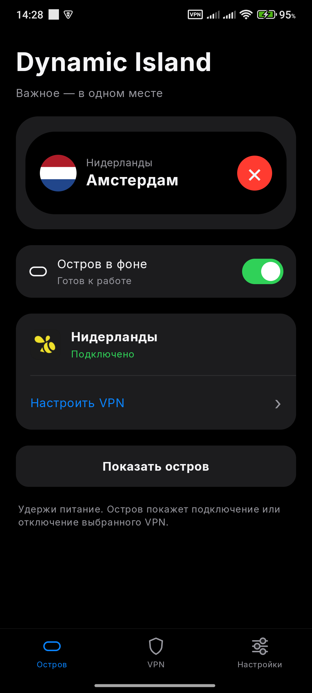
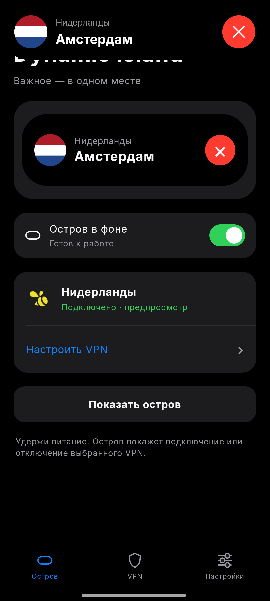

# Android Dynamic Island

A black animated island for VPN control on Android. Hold the physical power button to switch your connection without opening another app.

**Kotlin · Jetpack Compose · Android 12+ · Encrypted local profiles**

[Download APK](https://github.com/JazzyBeen/AndroidDynamicIsland/releases/latest) · [Build from source](#build)

<p align="center"></p>

## Возможности

- Встроенный VPN на базе sing-box: подключение без открытия стороннего клиента.
- Импорт ссылки VLESS или конфигурации sing-box с одним сервером. Для совместимых провайдеров — получение конфигурации по HTTPS-адресу API и ключу доступа.
- Ключи и профиль шифруются через Android Keystore; резервное копирование отключено.
- Чёрный непрозрачный остров, одинаковые отступы от верхнего и боковых краёв, скругление по экрану телефона.
- Одна капсула появляется из физического выреза камеры. Сначала — флаг, страна, город/сервер и крестик; затем остров плавно сжимается в компактную капсулу и через две секунды возвращается в вырез. Мягкое растяжение и размытие движения сохранены.
- Крестик скрывает остров. Нажатие вне него сразу запускает скрытие и проходит в приложение под ним; обновления закрытого уведомления не открывают его повторно. В компактной версии показано измеренное время HTTPS-проверки туннеля, а не фиксированный или ICMP-пинг.
- Настраиваемая точка появления: автоматическое определение выреза либо ручные X/Y, с маркером на экране и отдельной проверкой анимации. Координаты сохраняются между запусками.
- Остров закреплён на камере: компактная капсула охватывает вырез, а при раскрытии верхняя граница не опускается.
- Нажатие на компактную капсулу снова раскрывает её. После сжатия — короткое мягкое растяжение с возвратом к обычному размеру; цикл показа запускается заново.
- Автоматический радиус берётся из `RoundedCorner` экрана, ручное скругление также применяется. При скрытии маленькая капсула сначала сужается; после 70% сжатия по ширине начинается уменьшение по высоте и исчезновение в вырезе.
- Короткие компактные оповещения о неожиданном отключении VPN, потере/восстановлении сети и 20 секундах без передачи данных. Простой не считается ошибкой; повторные сообщения о нулевом трафике ограничены двумя минутами. Оповещения можно выключить в настройках.
- Разделы приложения: остров, VPN, настройки. Плитка быстрых настроек и сохранение параметров между перезапусками.
- Альтернативный режим управления установленным VPN-клиентом. Его возможности зависят от API самого клиента.

## Настройка

1. Установите подписанный APK из Releases.
2. В разделе VPN выберите встроенное подключение. Импортируйте конфигурацию либо укажите HTTPS-адрес совместимого API провайдера и свой ключ. Ключ отправляется только на указанный сервер; редиректы запрещены.
3. Подтвердите системное разрешение VPN. Одновременно Android поддерживает один активный VPN: подключение острова заменяет подключение другого клиента.
4. Разрешите уведомления фоновой службы и включите Dynamic Island в специальных возможностях. Для APK может потребоваться «Разрешить ограниченные настройки» в информации о приложении.
5. В настройках острова выберите его цифровым ассистентом. В настройках телефона включите вызов ассистента удержанием питания. Это заменяет текущего ассистента; голос и микрофон не используются.
6. Разрешите автозапуск и работу без ограничений батареи, если этого требует прошивка.

Для встроенного VPN доступ к уведомлениям других приложений не нужен. Фоновые службы используют тихие обязательные уведомления Android.

### Кнопка питания

Обычное приложение не перехватывает аппаратную кнопку напрямую. В основном режиме Android вызывает невидимую сессию цифрового ассистента, которая переключает VPN и показывает остров. Меню выключения и окно клиента не нужны. На заблокированном экране переключение не выполняется.

Если приложение не назначено ассистентом, остаётся запасной путь через распознавание системного меню питания. Тогда меню может кратко появляться. Поведение аппаратной кнопки зависит от настроек и прошивки телефона.

### Совместимость

Встроенный режим поддерживает протоколы, включённые в указанную сборку sing-box, и требует совместимой конфигурации. Ключ произвольного VPN-сервиса сам по себе не заменяет серверный профиль. Адаптер API понимает `connection/list` и `connection/connect`; это не универсальный API всех провайдеров.

Импортируются параметры одного proxy-outbound. Исходные правила маршрутизации, API управления, внешние файлы и списки приложений не выполняются. DNS передаётся через туннель; отдельный прямой DNS используется только для разрешения имени самого VPN-сервера, если вместо IP указан домен.

Для внешних клиентов сначала используются действия из их уведомлений, затем известные команды и Accessibility. Внешний клиент может открывать своё окно. Полностью фоновое подключение предоставляется встроенным режимом.

## Приватность

Нет аналитики, записи микрофона и снимков экрана. Служба ассистента отключает получение assist-data и screenshots. Остров не читает фон под собой. Accessibility используется для наложения и запасного управления выбранным внешним клиентом.

Интернет нужен для VPN, HTTPS-загрузки профиля с выбранного сервера и проверки туннеля через Cloudflare / Google `generate_204`. Статус «Подключено» выставляется после успешной проверки сети. Ключи, конфигурации, IP и содержимое трафика в журнал не записываются. Личные профили и ключи подписи не входят в репозиторий или общий APK.

После принудительной остановки в системных настройках приложение нужно открыть снова. Автозапуск восстанавливает остров, но не подключает VPN без команды пользователя.

## Build

Android Studio, SDK 36, JDK 21, Go 1.25.8, Android NDK 28.0.13004108. PowerShell 7 is used on Windows and Linux.

```powershell
./scripts/BuildVpnCore.ps1 -AndroidHome /path/to/sdk -NdkHome /path/to/sdk/ndk/28.0.13004108
./scripts/Build.ps1 -Test
```

The first command builds `local/libbox.aar` from the exact upstream revision. The second builds the app, runs unit tests and Android Lint. On Linux, after building the core:

```sh
./gradlew :app:assembleDebug :app:testDebugUnitTest :app:lintDebug
```

For a signed release, put your own keystore settings in ignored `local/signing.properties` (`storeFile`, `storePassword`, `keyAlias`, `keyPassword`) and run `scripts/Build.ps1 -Release`. Never commit that file or a user profile.

```text
core/          Power-menu recognition, animation, geometry, state checks
data/          Preferences and Keystore-encrypted profile storage
vpn/           Coordinator and external-client adapters
vpn/embedded/  VPN service, sing-box platform adapter, profile/API import
system/        Assistant, Accessibility, notifications, boot and QS tile
overlay/       WindowManager overlay and temporal motion compositor
ui/            Compose tabs, permissions, client and profile setup
```

Tests cover power-menu debounce, geometry, animation phases, connection state, profile selection, VLESS parsing and rejection of external file references. Debug-only diagnostic activities are absent from release APKs.

## License

GPL-3.0-or-later. See [LICENSE](LICENSE) and [third-party components](THIRD_PARTY.md). The project is independent of Apple and any VPN provider.
